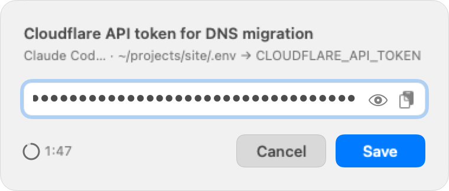

<h1 align="center">ez-secret</h1>
<p align="center">Let AI coding agents ask you for API keys and passwords without ever seeing them.</p>
<p align="center">   </p>
<p align="center"><picture>
    <source media="(prefers-color-scheme: dark)" srcset=".github/assets/panel-dark.png">
    
</picture></p>

## Why

- Paste an API key into an agent chat and it is saved in session history on disk and sent to the model provider.
- It stays in the transcript, context and logs of later work.
- ez-secret keeps the value out of all of that.

## How it works

1. The agent runs one command saying where the secret goes.
2. You type or paste it into a native macOS popup.
3. The value goes straight to a `.env` key, a file or the Keychain (file writes are atomic, mode `0600`); the agent only gets metadata like `stored: env-file /path/.env key=OPENAI_API_KEY, length: 51`.

```sh
ez-secret --label "OpenAI API key" --env-file .env --key OPENAI_API_KEY --no-digest
```

## Install

```sh
brew install lorenjphillips/tap/ez-secret && npx skills add lorenjphillips/ez-secret -g -y -a claude-code -a codex
```

The first part installs the tool, the second the agent skill (other agents: `npx skills add lorenjphillips/ez-secret`; or paste [snippets/AGENTS.md](snippets/AGENTS.md) into AGENTS.md / CLAUDE.md). macOS 14+.

From source: `swift build -c release`.

## Usage

```sh
ez-secret --label "API token" --env-file .env --key API_TOKEN
ez-secret --label "API token" --file ~/.api-token
ez-secret --label "API token" --keychain-service my-app --keychain-account default
```

Run `ez-secret --help` for all flags and exit codes.
`--timeout` defaults to 120 s (minimum 15); `EZ_SECRET_TIMEOUT` changes the default, and `--timeout` overrides it.

The value never passes through the agent, but a `.env` or file is still readable by anything running as you, including the agent’s shell; the Keychain is the safest destination for high-value secrets.

License: [MIT](LICENSE).
